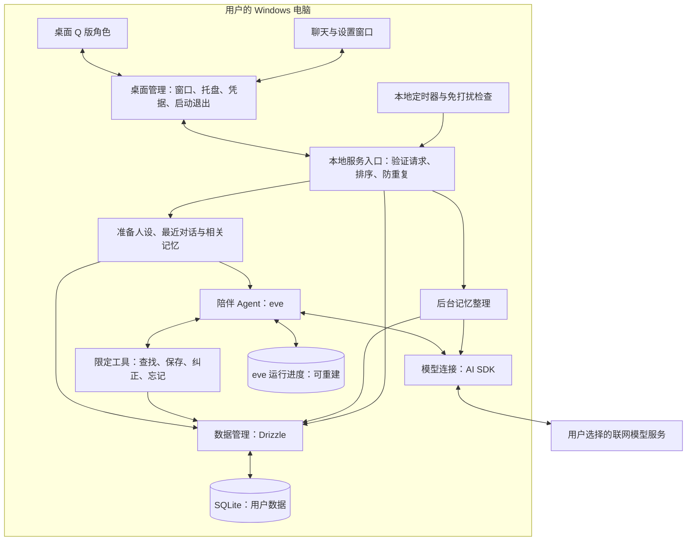

# 03 · 架构与技术选择

## 1. 总体结构

下面是目标设计，不代表已经完成兼容性验证。



图片、聊天和记忆保存在电脑上。发给模型的是当前需要的设定、文字和工具结果，不会自动上传整个数据库或截图。设置页清楚解释聊天和记忆整理都可能联网。

## 2. 固定的主要选择

“固定”指开发基线，允许正常安全升级；确需更换时按 08 记录原因、影响和数据延续方式。

| 部分 | 选择 | 职责与说明 |
|---|---|---|
| 语言 | TypeScript | 统一编写界面和本地业务逻辑 |
| 桌面 | Electron | 窗口、透明桌宠、鼠标命中、托盘、系统事件 |
| 界面 | React + CSS Modules | 页面与样式；首版使用 React 自带状态管理，不额外引入全局状态库 |
| 构建 | electron-vite | 编译桌面和界面代码 |
| Agent | eve，首选、待 T01 实测 | 管理模型与工具运行；不开放自我修改人设、Shell、文件任意访问能力 |
| 模型交互 | AI SDK | 流式文字、模型连接、结构化输出；由 eve 适配层统一接入，不再叠一套独立对话循环 |
| 输出检查 | Zod | 验证界面请求、工具参数、记忆候选结果的格式 |
| 用户数据 | SQLite | 一台电脑本地使用，不要求安装数据库服务器 |
| 数据读写 | Drizzle + better-sqlite3，驱动待 T01 验证 | 表定义、查询、版本升级；后台服务单点写入 |
| 依赖管理 | npm + package-lock.json | 固定已验证版本，使用 npm ci 重现安装 |
| 运行环境 | 开发采用 Node.js 24 系列，具体补丁待验证后锁定 | Agent 打包独立 Node 环境；不假定 Electron 自带版本必然匹配 |
| 安装包 | electron-builder，Windows NSIS 目标 | 普通安装包；自动更新后续增加 |
| 密钥 | Electron safeStorage | 用系统提供的加密能力保存；后端只在内存拿到解密值 |
| 检查 | Vitest + TypeScript 检查 + Windows 手工验收 | 数据和流程自动检查；透明窗口、休眠、安装真实验证 |
| 中文关键词 | Intl.Segmenter + 精确词匹配，待中文召回检查 | 不把英文分词方式直接当成中文搜索质量保证 |

eve 要求 Node.js 24 或更新版本，其手动安装包含 eve、ai、zod。[官方入门说明](https://eve.dev/docs/getting-started)

AI SDK 提供工具调用和循环终止机制。我们的应用仍需定义明确的次数、时间、预算限制。[官方运行控制说明](https://ai-sdk.dev/docs/agents/loop-control)

SQLite 的 Drizzle 接入有官方支持；驱动与安装包中的 Node 环境仍需我们测试。[Drizzle SQLite](https://orm.drizzle.team/docs/sqlite/get-started-sqlite)

## 3. 两个窗口与本地后台进程

### 桌面部分

- 主进程在创建窗口、启动后台服务和定时任务前调用 `app.requestSingleInstanceLock()`；获取失败立即退出。后续启动只通知已有实例，不再启动第二套服务、整理或主动消息计时器；通知本身不触发模型调用。[Electron 单实例接口](https://www.electronjs.org/docs/latest/api/app#apprequestsingleinstancelockadditionaldata)
- 角色窗口与聊天窗口独立。缩小角色时同步收缩窗口，不保留巨大的透明挡点击区域。
- 角色窗用无边框透明窗口；缩放由菜单/滑条与 Ctrl 滚轮控制。先验证透明窗口的实际限制，不依赖系统拖边框缩放。
- 按图片透明度或合理轮廓做鼠标命中；有色部分可点击，透明部分尽量穿透。
- 窗口位置保存相对屏幕信息；显示器拔除或缩放变化时把角色放回可见区域。
- 浏览界面不直接读数据库、不持有模型密钥、不具备 Node 任意执行能力。

Electron 透明窗具有平台限制，相关窗口行为需要真实机器验证。[窗口文档](https://www.electronjs.org/docs/latest/tutorial/custom-window-styles)

### 后台部分

桌面主程序启动本地业务 Node 进程，由业务进程再启动 eve 编译产物的独立 Node 服务，即「Electron → 业务后台 → eve」。两个后台只监听 `127.0.0.1` 的随机可用端口，各自使用每次启动新生成的令牌；界面只经桌面管理部分访问业务后台，不持有 eve 的端口凭证。eve 0.80.1 采用官方自托管构建方式，当前没有采用未经文档支持的嵌入 API；打包时两者使用安装包自带的 Node，具体装包仍待 T01 后续实测（08 C01）。

T01 这一步每次启动使用新的 eve 执行目录，并关闭框架启动时自动重发旧任务，避免技术自测意外重复付费。正式恢复以后由业务后台读 SQLite 的任务和版本状态，重建 eve 上下文；不能从 eve 的旧运行文件推断聊天或记忆。退出时取消请求、完成必要落库后回收后台；eve 另检查父进程是否还在，防止 Windows 强制结束业务后台留下孙进程。目前已验证无活动调用时正常退出和强制结束后台的回收；运行中取消与落库验收仍在后续任务。

模型密钥在主进程解密后，经父子进程专用 stdin 管道，或已通过本次会话令牌认证的本地通道传给后台，仅留在内存；禁止通过命令行参数或环境变量传递。当前两跳管道格式：Electron → 业务后台为「业务令牌\n模型密钥\n」，业务后台 → eve 为「模型密钥\neve 令牌\n」。初始化会话令牌同样通过专用管道交付，不写入日志或渲染进程。eve 在 `step.started` 回调内从内存创建供应商模型，带密钥的模型对象不进入工作流检查点。生产 eve 的原始 stdout/stderr 不转发、不落日志，避免第三方错误对象夹带提示词；应用只报状态码、耗时和用量。T01 要验证首次传递、重新配置与后台重启后的传递，以及未认证请求被拒绝；本次已验证首次和重启，运行期重新配置仍待完成。

采用独立进程是为了避免记忆整理、数据库读写拖慢界面，并独立满足 Node 版本要求。启动入口、构建产物、关闭行为和端口认证都属于 T01 验证，未写虚构 eve API。

### 运行恢复与用户数据分开

SQLite 保存用户拥有的角色、对话、记忆和任务状态，是产品数据的依据。eve 自己的磁盘数据仅用于当前执行过程，不能成为聊天记录唯一来源。

eve 文档说明本地升级框架版本可能造成旧运行会话无法继续。应用维护独立会话 ID，升级后可新建框架运行会话并用自己的数据接续，不能承诺中断中的模型调用原地恢复。已经写入的工具操作依靠操作编号避免重做。[eve 本地运行与升级说明](https://eve.dev/docs/concepts/execution-model-and-durability)

## 4. 文件结构（目标，不是已生成源码）

```text
src/
  desktop/       窗口、托盘、加密凭据、启动后台服务
  bridge/        界面允许发送的固定请求
  ui/            桌宠、聊天、设置、记忆页面
  service/       聊天入口、排队、取消、主动互动
  agent/         eve 适配、人设准备、模型连接、工具定义
  memory/        提取、查找、合并、纠正、忘记
  data/          表定义、查询、数据库升级
  jobs/          后台整理、定时机会、重试
  shared/        各部分共同使用的数据格式
agent/           eve 作者目录：模型配置、临时说明、路由认证（与 src/agent 分工不同）
scripts/         本地构建、eve 启动与固定输入贯通检查
characters/      角色样稿与原创示例，不放 API 密钥
tests/           数据、流程与角色评测样例
docs/sdd/        本套开发规格
```

正式人设从应用管理的数据加载；T01 的 `agent/instructions.md` 仅作技术测试身份。eve 配置显式关闭默认文件、Shell、网页工具和复制自身的子 Agent；即使框架支持文件指令，也不允许其自我修改功能绕过角色版本管理。记忆提取用单独提示词和固定流程，不创建第二个自由行动的 Agent。

## 5. 模型接入约定

- 模型、地址、凭据引用由配置控制，不写死在界面代码。
- 首版验收至少覆盖一种验证过的路径：AI Gateway 或一个经过验证的供应商接入。用户自定义地址仅在对应适配器与工具调用检查通过后列为“已支持”。
- 不把 ChatGPT 订阅当成任意 API 的凭据；软件不承诺订阅可直接使用。
- 首轮试聊比较候选模型的中文人设、工具调用、格式遵从、等待时间、用量；同一套案例比较，记录模型名称及日期。
- 整理默认可以复用聊天模型，但通过单独配置槽位保留将来使用不同模型的能力。不能仅因更便宜就接受记忆质量下降。
- 首版不添加工具调用失败时另一套临时文本解析方案；明确报告当前模型不支持该功能，要求选择验证通过的配置。

## 6. 稳定边界：以后增加能力时改哪里

| 新能力 | 新增/修改部分 | 不应被迫改动 |
|---|---|---|
| 多角色切换 | 界面与角色管理 | 消息归属、记忆来源、数据库主结构 |
| 语义检索 | memory 中的查找实现和可重建索引 | 聊天页面、人设版本 |
| 应用感知 | 新的事件来源及用户设置 | 回复流程、免打扰、气泡展示 |
| 新模型 | 模型连接适配器和兼容性记录 | 数据库中的用户事实 |
| 新提醒工具 | 工具定义、任务规则、验收 | 角色展示与基础聊天 |

## 7. 发布前的基础约束

- 界面启用隔离与沙箱，禁用 Node 直接访问；检查消息发送方和请求参数，限制导航。[Electron 安全说明](https://www.electronjs.org/docs/latest/tutorial/security)
- safeStorage 加密不可用时，凭据仅保存在当次运行内存，不降级为明文落盘。[safeStorage 文档](https://www.electronjs.org/docs/latest/api/safe-storage)
- 检查后台启动参数、环境变量和普通日志均不含模型密钥或会话令牌；密钥只经 §3 的受控通道传递。
- 日志默认只记操作 ID、错误码、耗时与用量，不记原始对话、完整提示词或密钥。用户主动导出诊断也要脱敏。
- 普通聊天和主动消息遵循相同人设，但数据库写入权只在程序工具中。
- 安装包在没有开发环境的 Windows 账户验证；包括中文路径、空格路径、写入权限与 native 驱动加载。

具体软件库版本在 T01 通过后写入 08；本阶段不凭空列一个“已经兼容”的版本组合。
