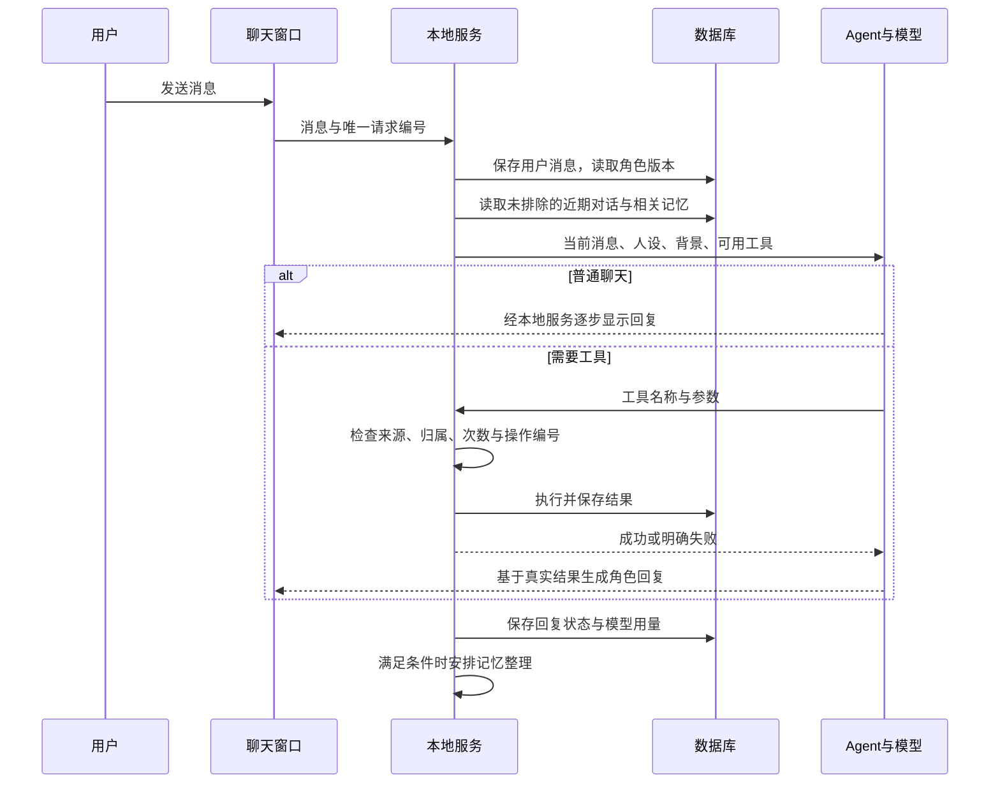
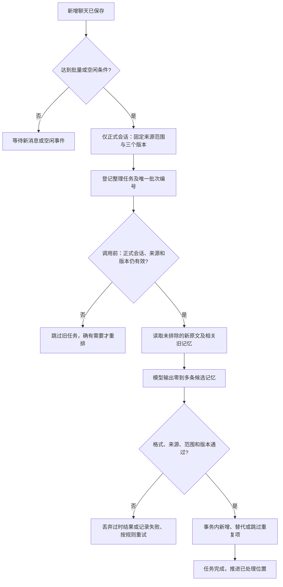
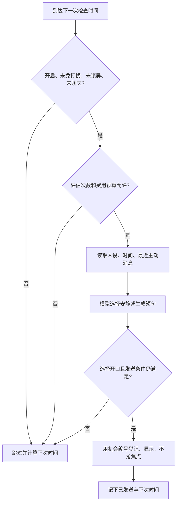

# 04 · Agent 工具与运行流程

## 1. 每次聊天的过程



界面实际只与本地服务通信，图中回复箭头表示最终显示路径。涉及保存操作的中间模型文字不直接展示成“已保存”；应用先执行工具，再展示最终结果。普通无工具回复保持流式显示。

打开角色聊天时，服务解析并复用该角色唯一的正式会话（`mode='normal'`），再次打开不新建；首次初始化角色时同时建立人设、正式会话与设置。首版没有新建或清空聊天入口。切换到其他角色的入口时加载其独立历史和私有记忆，仅明确共享的资料可跨角色使用；试聊使用单独的 `preview` 会话。

## 2. 一次回复的输入

按顺序放入：共同事实规则 → 角色核心设定和版本 → 少量相关示例 → 用户明确共享资料 → 相关记忆 → 未排除的近期对话 → 当前消息或事件。

起始上下文总预算 12,000 token，并同时受模型实际窗口大小减去输出预留约束；默认输出上限 1,000 token。优先保留核心人设和当前消息，然后相关记忆、近期对话；必要时减少较早对话和示例。核心设定本身过长时在编辑页提示缩短，不静默截掉核心性格。用户单条输入首版限制 8,000 字符，超限提示分段。

上述排列是提示内容的组织顺序，不是超预算时的保留优先级。8,000 字符不等于 8,000 token，也不保证一定放得进实际模型窗口；每次调用（含工具续轮）都检查总输入与输出预留。删减可选内容后核心人设与当前消息仍放不下时，提示缩短输入/设定，不静默丢掉当前消息。完整历史仍可在本地查看，但只选预算内内容发给模型；摘要仍在第四阶段。

记忆、工具返回、聊天原文是资料，不允许覆盖产品规则。已取消/失败的角色片段不作为可靠经历。服务层根据会话 `mode` 拒绝试聊写入正式长期记忆，包括立即记忆工具；不能只依赖提示词约束。

本轮人设和可用消息从 SQLite 一起读出为独立资料，回合中途不重读“当前人设”，下一轮才跟随保存或回退后的版本。当前用户消息单独保留，历史边界固定在它之前；同一用户消息有多份回复时，先选边界内最新的一份，再检查是否完整、未被排除。最新回复不可用时不退回旧版；被排除的用户原话及依赖它的回复也不进入上下文。供用户查看的历史仍可保留这些原文，不能直接用展示接口的结果当模型输入。

默认每轮最多 3 次模型生成、4 次工具执行、总用时 90 秒；开始等待首段文字超过 30 秒显示等待状态，超时结束。额度、时限在程序控制，不能由模型自行延长。

## 3. 应用与 Agent 之间的约定

下面是我们自己的接口草图，不是 eve 或 AI SDK 已存在的方法名。实现时按所安装版本的官方文档适配。

```ts
type TurnInput = {
  requestId: string;        // 重试沿用同一个编号
  conversationId: string;  // 后端据此解析角色，不能信任模型自选角色
  userMessageId: string;
};

type TurnEvent =
  | { type: 'text'; delta: string }
  | { type: 'tool-status'; label: string }
  | { type: 'done'; messageId: string }
  | { type: 'failed'; code: string; retryable: boolean };

interface CompanionRuntime {
  run(input: TurnInput, signal: AbortSignal): AsyncIterable<TurnEvent>;
  invalidateContext(conversationId: string): Promise<void>;
}
```

应用会话 ID 与框架会话 ID 分离。数据库 `conversations.runtime_session_id` 可更换；用户看到的聊天会话不变。

## 4. Agent 可以使用的工具

后台自动补入的相关记忆可以满足多数聊天；`search_memories` 用于用户追问旧事或当前背景不足时。工具只返回有限结果，不直接暴露数据库。

| 名称 | 何时使用 | 模型提供的输入 | 返回内容 |
|---|---|---|---|
| `search_memories` | 需要找旧信息 | `query`、可选 `limit`（最多 8） | 记忆 ID、内容、来源属性、时间、修订号 |
| `remember_explicit` | 用户明确要求记住 | `content`、`kind`、`memoryKey?`、`sourceMessageId` | `memoryId`、`revision`、`saved/already_saved` |
| `correct_memory` | 用户明确纠正 | `memoryId`、`expectedRevision`、`content`、`sourceMessageId` | 新记忆 ID 或冲突说明 |
| `forget_memory` | 用户明确要求忘记 | `memoryId`、`expectedRevision`、`requestMessageId` | 忘记完成或需要明确对象 |

角色范围、共享范围、操作编号由后端注入，模型不能指定任意角色或任意用户。首版全局共享只由设置页切换或明确的共享操作处理，普通记忆工具默认当前角色。

每个工具统一返回：

```json
{
  "ok": false,
  "code": "STALE_REVISION",
  "message": "这条记忆刚被更新，请读取新版本后再处理",
  "retryable": true
}
```

其他错误码：`INVALID_INPUT` 参数不合法、`SOURCE_NOT_ALLOWED` 来源不属于当前可用消息、`NOT_FOUND` 无可访问对象、`AMBIGUOUS` 指代不清、`BUDGET_EXCEEDED` 超预算、`STORAGE_UNAVAILABLE` 无法落盘、`CANCELLED` 已取消。

输入检查能验证消息归属、版本和字段，不能完全证明“用户是否真的表达了这个意思”。明确要求的识别依然需要模型理解，靠示例、来源审计、用户纠正和验收降低误判。没有明确要求时用后台候选流程，不能调用立即记忆工具绕过规则。

## 5. 只有程序可调用的功能

| 功能 | 职责 |
|---|---|
| `build_context` | 预算内准备人设、最近对话、相关记忆；过滤被忘记来源 |
| `extract_candidates` | 用新增对话提取候选项，返回规定格式 |
| `commit_candidates` | 在事务内检查冲突与版本并写入 |
| `publish_bubble` | 发送前检查开口条件，写入发送记录并显示 |
| `rebuild_runtime_context` | 纠正/忘记后淘汰旧缓存，用干净上下文新建运行会话 |
| `migrate_database` | 软件升级时备份并升级结构 |

不提供任意 SQL、Shell、随意读写文件、自改人设工具。程序计时，模型不负责“持续盯着时间”。

## 6. 自动整理的全过程



候选格式示例：

```json
{
  "candidates": [{
    "action": "add",
    "kind": "preference",
    "memoryKey": "preferred_name",
    "content": "用户希望被称为阿达",
    "sourceMessageIds": ["msg-user-001"],
    "expiresAt": null,
    "replacesMemoryId": null
  }]
}
```

允许 `add / replace / skip`。`replace` 必须给出实际旧记忆 ID，程序核对归属和修订号；不允许模型通过该流程直接删除记录或改人设。事实来源主要为用户消息；“讨论过某个话题”的经历需要实际对话支持，不能将角色编造的细节变成事实。

服务层在登记任务、调用模型前和提交候选时检查 `mode='normal'`；`preview` 不进入正式整理，即使直接调用内部接口或恢复旧任务也须拒绝。任务记录角色记忆版本、共享记忆版本及该会话 `context_epoch`，读取来源时排除已忘记消息。

用户纠正、忘记或删除来源后，只处理依赖变化内容的范围：①尚未开始的受影响任务标为 `stale` 并跳过，真正调用模型前再核对版本；②运行中的受影响任务尝试取消；③提交事务仍核对三个版本和来源权限，任何旧结果都不得写入或推进已处理位置。检查后到模型调用之间发生变化也由取消和提交检查兜底；已发生用量不保证因取消退回。

只有剩余可用来源确实仍需整理时，才基于新状态登记新批次；不无条件重做所有角色的任务。角色私有变更限制在相关角色/会话，共享变更影响实际依赖共享资料的运行；关联无法细分时作废该依赖范围内的上下文，不能沿用可疑旧内容。具体版本用途见 05 §4。

同一批次完成标记、写入、处理位置一起提交。即使已获得模型回复后程序崩溃，也只会重新请求或重用已落库结果，不产生两份记忆。

## 7. 忘记的全过程

1. 确认目标记忆可访问，且当前用户确实提出忘记请求；指代不清则问具体对象。
2. 停止受影响的旧回复并尝试取消模型调用，已显示部分标为“未完成”，拒绝其后续片段和完成事件；提升相关角色/共享记忆版本及受影响会话的内容版本，使旧整理和回复失效。
3. 同一事务里清空目标及同一属性链相关历史正文，清理来源片段、关键词/未来向量索引，登记来源消息排除范围。
4. 按 §6 跳过受影响的待执行整理、尝试取消正在运行的整理，并保持提交版本检查；其他依赖被排除来源的记忆也失效或从剩余独立来源重建。第四阶段有摘要后，同步标为失效，首版不新增摘要生成。
5. 废弃旧框架会话，清理应用可控制的运行缓存和调试落盘副本，用经过过滤的历史重新建立上下文。
6. 确认新上下文无该信息后，才告知“已忘记”，随后才能基于干净上下文继续回复。若缓存清理失败，显示处理中/失败，不报告成功。若忘记来自当前回复中的工具调用，该旧运行同样失效，成功提示由服务确认或由重建后的运行生成。

首版对多事实同条消息采用整条排除，不承诺精准删除句中一个词。之前已经发送给模型服务的内容无法通过本地删除撤回；设置说明服务商数据处理范围。手动导出的旧备份也不会被静默改写。

## 8. 主动互动流程



气泡交付由唯一机会 ID 去重。首版优先避免重复打扰：先登记已安排，再通知窗口；崩溃可能丢一条气泡，不自动重播。文档不承诺跨进程崩溃下视觉显示“恰好一次”。

每次机会固定发出消息的角色 ID；`publish_bubble` 由服务定位该角色的正式会话，将 `role='proactive'` 消息和发送记录关联保存，并核对二者的角色一致。不取当前打开窗口的会话 ID，不写入其他角色或 `preview` 会话。没有有效正式会话时跳过并记录原因，不临时创建试聊或跨角色代发。

## 9. 取消、断网、退出

- 点击停止：取消正在等待的模型和流式显示；尚未开始的工具不再执行。
- 已经提交的数据修改不能假装被撤销。界面保留“称呼已保存”等实际操作状态，重试不会再写一次。
- 网络重试只针对可安全重试步骤；工具写入通过操作编号去重，不能把整轮无条件重放。
- 数据库不可写时，保留本轮可见文本并明确“未保存”；恢复后按原请求编号重试保存。
- 退出时取消请求并保存已提交状态；再次启动把过期运行租约恢复到可重试，主动问候不补发。
- 改模型或人设不会重写旧消息；新运行记录实际使用的版本和模型，便于定位质量变化。
