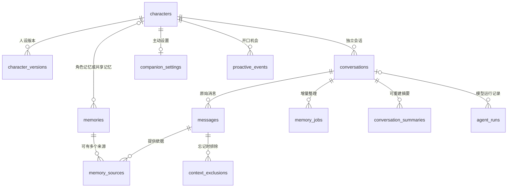

# 05 · 数据与升级设计

## 1. 保存原则

- 本地 SQLite 是用户数据的正式记录。eve 的运行文件可重建，不代替聊天与记忆表。
- 应用数据放 Electron 的用户数据目录，具体使用系统 API 获取；不放安装目录、不硬编码用户名。
- ID 用程序生成的不重复字符串；时间统一用 UTC 毫秒整数，显示时转用户时区。
- 每个数据库连接启用外键检查。生产开启 WAL（边读边写的日志方式），写事务短小；模型请求必须在事务外等待。
- 一个后台服务负责写入。全部角色范围由服务计算，不能相信模型传来的归属。
- [schema.sql](schema.sql) 是可执行的空库结构样稿。正式开发由同一结构生成 Drizzle 定义和带编号的升级脚本，不能把 CREATE IF NOT EXISTS 当作升级机制。

## 2. 表及用途

| 表 | 保存什么 | 重要字段 |
|---|---|---|
| `schema_migrations` | 已执行的数据升级 | 版本、摘要校验、时间 |
| `app_state` | 共享记忆的当前版本 | `global_memory_epoch` |
| `characters` | 角色入口、两张图、记忆版本 | ID、名字、图片路径、`memory_epoch` |
| `character_versions` | 人设和关系设定的历史 | 角色 ID、版本号、人设、示例、是否当前版本 |
| `conversations` | 会话和整理进度 | 角色 ID、正式/试聊、框架会话 ID、`context_epoch`、已整理位置 |
| `messages` | 真实消息及完成状态 | 会话 ID、顺序、身份、正文、请求编号、是否排除 |
| `memories` | 长期记忆及新旧关系 | 归属、类别、键、内容、来源类型、状态、修订号、时间 |
| `memory_sources` | 一条记忆对应哪些原始消息 | 记忆 ID、消息 ID；不复制原文片段 |
| `context_exclusions` | 哪些旧消息不再进入模型和整理 | 消息 ID、范围、原因、时间 |
| `memory_jobs` | 批量整理范围和重试 | 起止顺序、角色/共享/会话内容版本、状态、租约、次数 |
| `conversation_summaries` | 将来的可重建摘要 | 来源范围、生成时版本、有效状态；首版可为空 |
| `companion_settings` | 主动陪伴规则 | 开关、间隔、免打扰、时区、下次触发时间 |
| `proactive_events` | 每次主动开口机会 | 角色、计划时间、结果、关联消息、原因 |
| `tool_operations` | 防止重复执行的凭据 | 操作编号、动作、目标、返回 ID、执行状态 |
| `agent_runs` | 用量、耗时、错误与版本 | 模型、角色版本、触发类型、token、是否估算 |
| `app_settings` | 其他非机密设置 | 键、JSON 值、更新时间 |

表看起来多，但多数只存一类很小的数据。它们用于把“用户拥有的内容”“后台工作进度”“可重建缓存”分清，不需要一次开发全部管理页面。

## 3. 数据关系图

全局记忆的 `character_id` 为空；数据库 CHECK 约束保证 scope 与角色字段一致。后台共享资料变更提升全局版本，各角色下一次运行均重新检查。

首版由服务层在事务中保证每个角色只初始化一条 `mode='normal'` 正式会话，后续打开复用其 ID；`preview` 独立保留。现有表结构不改成单会话专用结构，不新增会话列表页。任务登记、模型调用前和候选提交时均过滤 `preview`；正式记忆写工具也不得接受试聊来源。主动消息的会话必须是 `proactive_events.character_id` 对应角色的正式会话，归属由服务层核验，不能仅依赖外键。

## 4. 记忆字段说明

| 字段 | 含义 |
|---|---|
| `scope` | `character` 当前角色 / `global` 用户指定共享 |
| `kind` | `fact` 事实 / `preference` 偏好 / `episode` 经历 / `temporary` 近期状态 / `interaction_request` 明确相处要求 |
| `memory_key` | 可替换的具体属性，比如 `preferred_name`；经历可以没有固定键 |
| `content` | 给用户看、供模型读取的简短中文记录 |
| `origin` | `user_explicit` 用户明确说出 / `conversation_event` 有依据的经历 / `user_edit` 页面填写 |
| `status` | `active` 有效 / `superseded` 被替代 / `expired` 过期 / `deleted` 已忘记 |
| `revision` | 每次状态/内容变化递增，用于拒绝旧版本写入 |
| `supersedes_id` | 新记录替代的旧记录 |
| `valid_from / expires_at` | 什么时候有效、什么时候不再表示当前状态 |

不保存模型猜测出的“用户性格”作为确定事实。暂不增加一个看似精确的置信度分数代替来源证据。

### 会话内容版本 `conversations.context_epoch`

它是“这段会话可用内容的版本号”。忘记、删除来源或改变来源可用范围时，在同一数据事务中递增受影响会话的版本；依赖旧内容的整理任务通过 `memory_jobs.context_epoch` 识别并作废。正常追加消息沿用已固定的批次范围，切换角色本身不改变版本。

它与 `characters.memory_epoch`（角色私有记忆版本）、`app_state.global_memory_epoch`（共享记忆版本）各有用途，三者不能相互替代。私有变更只影响相关角色及依赖会话；共享资料变化提升共享版本，并按依赖使相关角色的会话上下文失效，不无条件重排无关任务。首版不能细分某次运行的依赖时，保守作废该相关会话上下文。第四阶段有摘要后，用摘要生成时记录的 `context_epoch` 判断是否失效，首版只保留字段和规则，不实现摘要。

## 5. 更新与防重复

同一归属下，同一个 `memory_key` 最多一条有效记录。数据库部分唯一索引兜底。检索按 `expires_at` 和状态共同过滤，不能等待状态清理才停止使用过期信息；历史展示注明已过期。写入新值前，在同一事务中先将同属性已到期的 `active` 旧记录改为 `expired` 并增加修订号；仍有效但被新值替代的改为 `superseded`，再插入新值，避免过期旧值占用唯一索引。

用户消息用唯一请求编号防重；再次点击重试重新生成回复时，沿用原用户消息但创建新的运行记录和回复版本，不插入第二条相同用户消息。

工具操作编号由程序生成，关联到原始用户消息及同一语义操作；单纯网络重放沿用编号。同一称呼请求在已经成功后再次到达，返回已有结果。不同措辞的语义重复需用属性键和归并规则处理，不能只靠随机 ID。

每次记忆变动提升 `characters.memory_epoch` 或共享版本；来源可用范围变化同时提升受影响会话 `context_epoch`。整理任务记下这三个版本，调用模型前与提交事务内均核对。用户纠正/忘记时，受影响的未开始任务标为 `stale` 并跳过，已运行的尝试取消；取消失败也不允许旧结果提交或推进整理位置。先完成版本失效，再处理取消通知，避免仅靠内存取消保护数据。

按依赖范围处理，只在剩余可用来源仍需整理时重排新任务；恢复租约时也先核对版本，不盲目重试旧批次。任务唯一键包含来源范围与三个版本，允许必要的新批次，又避免同一有效批次重复写。已发生的模型用量仍记录，不能承诺取消会退款。

## 6. 忘记、删除原文与卸载数据

### 忘记

- 目标正文清空，保留不含内容的删除标记和操作 ID；同一属性旧版本链一起处理，避免旧值重新生效。
- 排除相应来源消息、直接复述目标信息的当前删除请求消息，以及已知引用它的摘要/运行上下文；首版在关联不确定时整段运行上下文作废并重建。
- `messages.excluded_from_context` 用于快速过滤，`context_exclusions` 用于解释原因；二者同一事务更新。
- 其他记忆若仅依赖被排除的消息，也作废；有独立来源时可从剩余来源重新生成。
- 不在 `tool_operations.result_json`、错误日志、删除原因中复制被忘记的正文。
- 人设编辑页里用户手填的同一信息不会被自动改掉，检测到时明确提示它仍属于人设配置；不假称已从所有地方抹除。
- 已导出的手动备份单独提示；恢复时显示日期和恢复范围。应用管理的备份（包括升级前快照）若包含待忘记内容，要重建或删除旧副本；无法清理时告知具体范围，不承诺全盘擦除。周期性自动备份策略尚未定义，不能把上述副本清理规则当成已实现的自动备份功能。

### 删除原文

通过应用服务先找依赖记忆和摘要，再一起失效/删除，并清理运行存储，然后删除消息。不能只依靠外键删除 `memory_sources`，否则可能留下失去依据却仍有效的记忆。

### 清空角色

先停止相关运行与任务，再删除该角色的会话、人设版本、私有记忆和运行文件；用户明确共享到全局的数据保留，清空前展示范围。删除共享资料需单独指定。

### 首版数据入口与卸载

首版不提供清空聊天或新建会话入口；保留单条记忆纠正/忘记、明确选择同时删除相关原文、单条共享资料的明确删除，以及清空单个角色。不得用恢复或角色切换暗中清空现有聊天。

卸载提供两种选择：保留数据以便重装继续，或删除应用管理的数据后重装从头开始。删除前停止全部运行和任务，按应用管理路径清理聊天、记忆、人设、设置、加密凭据、缓存、运行文件、管理的图片副本和备份等；用户另行导出的文件和原始图片不自动删除。说明实际清理范围；失败时告知未清理部分，不承诺“删一处即净”。保留路径重装后仍需正常校验/迁移，不能通过重新初始化覆盖旧数据。

## 7. 软件升级

1. 停止新写入、结束/取消当前生成；不得在活跃任务中直接更换框架。
2. 使用 SQLite 备份 API 或等效一致性快照备份，不能仅复制开启 WAL 时的单个 `.db` 文件。
3. 验证备份可读取，再按编号执行迁移并校验。
4. 结构升级失败时回滚本次事务，保留旧库和备份，阻止用半升级数据启动。
5. 框架版本变化时清理旧运行映射，用应用保存的历史与记忆接续；已提交工具凭据保留。
6. 应用启动后执行完整性检查和版本匹配检查。旧版程序遇到更新的结构应拒绝写入并说明原因。

验收必须用上一个版本真实结构的样本库，包含至少两个角色、相同属性的不同值、被忘记消息、失败任务和主动发送记录。只测试空库启动不算通过。

### 启动检查失败后的基本恢复

完整性检查失败时停止正常写入和模型/后台任务，不把损坏库当空库初始化。保留损坏原库及相关 WAL 等文件，再检查现有升级快照或用户选择的备份是否可读取、完整且版本可兼容；不假设一定已有自动备份。

有可用备份时展示备份时间、恢复范围、可能丢失的备份后聊天/记忆/设置，以及旧备份可能恢复已忘记信息，由用户选择是否恢复；无法准确统计损失时明确说明。用户同意后在独立位置验证恢复结果，成功后才切换到恢复库，仍保留损坏原件；恢复失败或用户拒绝时不覆盖原库。无可用备份时明确告知，允许选择其他备份，不静默清空，也不增加复杂数据抢救系统。版本不兼容与完整性损坏分别说明，不能把新版本库误当坏库自动回退。

## 8. 初始数据与配置

- 创建一条 `app_state`，共享版本从 0 开始。
- 在事务中创建首个角色、一个当前人设版本、一条正式会话和该角色设置；重入时复用已有记录，不假设角色 ID 永远是 1。新增测试角色同样完整初始化，不是只插入角色表一行。
- 主动陪伴默认关闭；默认值参考 02。
- 模型配置只保存凭据引用、供应商、模型、可选地址，不存密钥。
- 未取得原图前只记录资源待定；不能把概念图里截出的界面当最终角色文件。

SQL 样稿中的约束只覆盖结构正确性；来源含义、同角色访问、删除后的缓存清理、租约恢复等仍需服务代码实现与测试。
