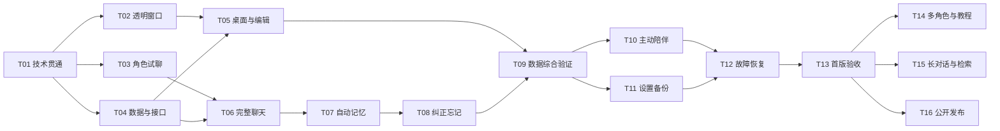

# 06 · 开发执行计划

## 1. 执行方式

先验证技术与角色，再实现桌面和记忆，最后补齐主动互动、安装升级与日用验收。每个任务按“阅读关联需求 → 实现 → 检查 → 记录证据”执行。不把任务勾选数量当成人设质量。

初始规格交付时所有任务均未开始。T01 技术贯通分步证据见 [T01 技术贯通记录](T01-技术贯通记录.md)。截至 2026-10-22，**T01 关闭（遗留挂账）**：开发态与免安装目录（win-unpacked）模拟检查覆盖认证、换密钥、后台重启退出、数据库两轮持久化与完整模型回合（状态/字数/用量）；安装版在本机开发账户确认新建库、迁移登记、读写落盘、三次启动版本号精确对应、双开无第二窗口且无额外写入、退出零进程；安装包指纹 `55B7311E…`。按用户决定挂后续补做：无开发环境账户验收与卸载（暂缓，可随 T11/T13）、`npmRebuild:false` 驱动复现与 NSIS 静默安装超时根因（挂 T11）。遗留项不阻塞 T02/T03/T04 开工。不能据此将 T01 整体标为完成。每项记录实际耗时、代码版本、检查结果和剩余问题；用户输入未定不妨碍不依赖该项的开发。

截至 2026-10-22，**T02 完成**：透明角色小样——本机实测 alpha=0 像素原生穿透、实心挡住；手动拖动、Ctrl 滚轮缩放（钉脚底、限幅）、右键恢复默认；位置经 `app_settings`（迁移 v2）与 `/window-state` 跨重启恢复，拔屏/缩放当场拉回可见区。自动检查 50 项全过；实机验收逐项通过（用户确认，录屏按用户意愿省略）。已知取舍与挂账见 [T02 透明窗口记录](T02-透明窗口记录.md)：启动「先中后跳」留 T05，多屏真机与多环境穿透复验挂 T13。

## 2. 第一阶段：技术与角色验证（5～7 个开发日）

| 任务 | 工作与产物 | 依赖 | 用时 | 完成证据 |
|---|---|---|---:|---|
| T01 | 最小 Electron + React + eve + 数据库贯通；构建 Windows 安装包，测试 bundled Node、驱动、端口认证、单实例锁和退出；验证 stdin/认证通道的密钥交付及后台重启；记录精确版本 | 无 | 2～3 日 | 无开发环境账户可启动读写；双开不启动第二套后台；未认证请求被拒；参数/环境变量/日志无密钥和令牌；后台退出无残留；版本报告 |
| T02 | 透明角色小样：鼠标命中、拖动、缩放、多屏位置恢复 | T01 基础窗口 | 1 日 | 实机录屏与显示缩放记录；透明区不挡点击 |
| T03 | 首个角色设定与 24 组试聊案例；比较候选模型并选一个首版配置 | T01 模型接入 | 1～2 日 | 盲评表、用量和耗时；角色达到 07 的阶段门槛 |
| T04 | 建立应用接口、数据库版本管理、最小旧库升级样例、工具操作编号；角色/共享/会话内容版本的事务更新；角色及唯一正式会话初始化 | T01 | 1 日 | 固定请求重复执行、升级失败回滚、初始化重入检查通过；自己的会话 ID 与框架 ID 分离 |

阶段一不是一次性网页演示。产物位于最终工程中，后续继续使用。T01 失败先定位原因；如果需要换 Agent 实现，形成 08 中的决策记录，在功能铺开前完成替换，不能把兼容性问题拖到第三阶段。

T03 不通过不能宣称产品可行；继续调整角色设定、示例或模型。可以同时完成独立的窗口工作，但不能以“先做其他功能”为由跳过角色门槛。

## 3. 第二阶段：桌面与记忆闭环（10～15 个开发日）

| 任务 | 工作与产物 | 依赖 | 用时 | 完成证据 |
|---|---|---|---:|---|
| T05 | 正式桌宠、双窗口、托盘、角色基础编辑、图片设置、位置保存，接入单实例行为 | T02、T04 | 2～3 日 | R01、R02、R05 对应案例通过；重启保持配置；重复启动无第二套窗口/后台 |
| T06 | 每角色独立聊天与历史续接，流式显示、停止、重试、人设版本、总输入预算；服务层隔离试聊 | T03、T04 | 2～3 日 | 模拟断网、失败、取消、重复发送和超预算；完成轮数重试不重复计数；绕过界面提交 preview 也不能写正式记忆；无新建/清空聊天入口 |
| T07 | 增量提取、来源、去重、时效、用量预算与中文关键词检索；用 A10 评估，留出检索改进和复测工作量 | T06 | 3～5 日 | 固定候选检查无效来源/格式/归属、重复批次、过期旧值与新值写入；模拟未知用量和限额；真实模型另测质量；A10 保持 18/20 门槛 |
| T08 | 纠正、忘记、来源排除、上下文重建和管理页面；待执行任务跳过、运行中取消、提交拒旧结果；中止受影响流式回复 | T07 | 2～3 日 | 用可控延迟模拟调用前/中/提交时的变更和取消失败；A11～A13 通过；私有变更不影响无关角色；清理后重启无旧内容 |
| T09 | 两个完整初始化的测试角色：独立正式会话、共享资料、历史/记忆跨重启综合检查 | T05～T08 | 1 日 | 同名属性、历史和主动消息归属不串用；重复打开复用正式会话；共享变更按依赖失效；不提前开发多角色切换页面 |

T07 的 3～5 日包含约 2～3 日基础实现及候选/时效检查、1～2 日检索评估、必要改进与复测；先用已有记忆检索，不强制每轮加一次关键词提炼调用。若改进需要超过预留时间或引入新模型/服务，按证据更新估时与费用记录，不能降低 A10 门槛或推到发布后。

T08 的 2～3 日包含删除路径和必要的竞态检查，建立在 T04/T07 已实现版本检查与来源追踪上；若未实现，不能为保时间省掉。模拟检查直接放在相关任务中，使用固定输入、模拟输出、可控时钟/延迟即可，不另建大型测试模拟平台。

## 4. 第三阶段：完整第一版（6～10 个开发日）

| 任务 | 工作与产物 | 依赖 | 用时 | 完成证据 |
|---|---|---|---:|---|
| T10 | 主动陪伴：间隔、免打扰、时区、安静选项、发送去重；固定到发出角色的正式会话 | T06、T09 | 1～2 日 | 模拟锁屏/聊天中跳过、重复机会及预览窗口；恢复不补发、不跨角色/试聊落库；无回应不追问 |
| T11 | 设置、凭据、费用记录、手动备份/恢复与升级快照；坏库基本恢复及忘记说明；卸载数据选项 | T09 | 2～3 日 | 测试备份可用/损坏/缺失、用户接受/拒绝和恢复失败；保留原库；密钥保护；卸载保留/删除后重装符合范围 |
| T12 | 异常综合检查与修复：后台崩溃、数据库不可写、重复工具、退出取消、过期租约及双开 | T10、T11 | 1～2 日 | 故障注入记录；覆盖任务恢复与取消失败；复核 A13/A20/A24；不重复调用、写入或冒泡 |
| T13 | 正式安装升级、多屏/缩放、性能、卸载重装、未签名安装说明；24 场景再评价和日用收敛 | T12 | 2～3 日 | 07 首版全部通过，含 A18/A25/A26；记录真实安装提示和限制，不保证任何环境都可绕过拦截 |

按本次拆分，前三阶段预计共 **21～32 个有效开发日**（5～7 + 10～15 + 6～10），日历预留约 **5～8 周**。原 16～23 日已包含 T12 异常检查与 T13 首版验收；本次增加来自 T01 安全交付验证、T06 会话与预算、T07 检索改进、T08 竞态、T11 恢复/卸载和 T12 综合修复的逐项复核，不是额外统一加 2～3 日测试费时。

这些仍是未实施前的规划估算，包含必要模拟检查、真实模型质量评测与首版验收，不承诺一次就能达标。日历留有反馈和问题定位余量，07 要求的至少 7 个自然日日用可与第三阶段交错；人设试聊和模型费用按实际服务计费，等待素材或更长用户试用需另算。

## 5. 第四阶段：完善和公开发布（另估 20～35 个开发日）

| 任务 | 工作 | 首版如何接续 |
|---|---|---|
| T14 | 多角色切换、角色包导入导出、制作教程 | 使用已有角色 ID、人设版本及各角色独立正式会话；不据此新增会话列表页 |
| T15 | 长对话摘要、更好检索、评测扩展 | 首版 A10 已须达标；本阶段才增加摘要，沿用来源与内容版本 |
| T16 | GitHub 开源发布文档、诊断、更新流程和更广环境验证；届时再议开机自启动 | 沿用迁移、日志和安装基础；暂不购买代码签名，不重建用户数据 |

第四阶段按日用反馈重新拆任务和估时。语音、应用感知、Live2D、账号云同步与自动操作电脑需新增需求编号，不自动夹进这些任务。

## 6. 任务依赖图



## 7. 每个任务的记录模板

```text
任务编号：
关联需求：
开始前条件：
实现内容：
检查步骤与结果：
证据位置（日志/截图/测试报告）：
实际使用的人设、模型、软件库版本：
已知问题：
状态：未开始 / 进行中 / 等待外部条件 / 完成
```

代码按模块逐项合并，不跨任务顺手更换整套框架。必要的调整先记录影响；普通细节在既定范围内由开发判断，不为每个实现选择反复要求用户确认。

## 8. 代码量与不确定性

当前规格比单纯聊天演示更完整，尤其包含记忆删除、上下文恢复、升级和角色评价。手写代码初估约 6,000～10,000 行，包括必要检查和配置，不含软件库、生成文件、图片。它是工作量参考，不是目标；不能为压行数删除正确性处理。

最大不确定性：eve 在 Windows 安装包中的实际运行、角色与模型组合是否达标、记忆语义质量、透明窗兼容性。前三项若不通过，应根据证据调整估时，而不是宣称“加一个提示词就解决”。
